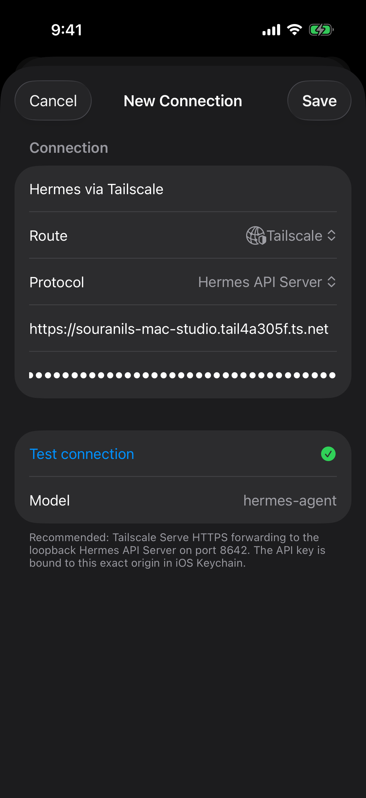
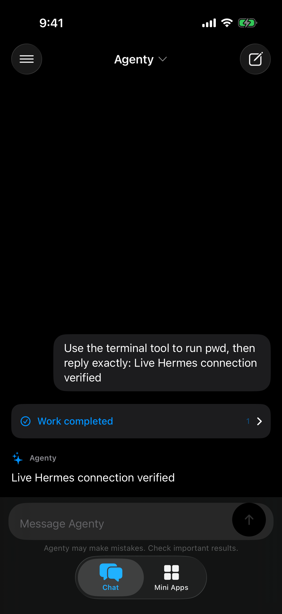
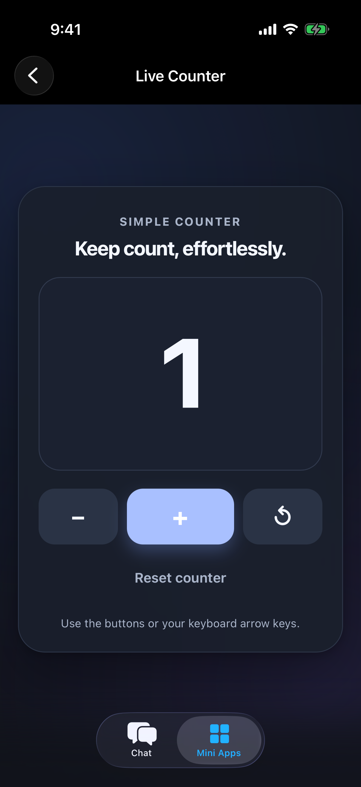

# Tether Flow for iPhone

Native iPhone chat and mini apps for a private, self-hosted Hermes Agent—provisioned by [Tether Host for Mac](https://github.com/sladebot/Tether-Host).

<p align="center">
  
  
  
</p>

<p align="center"><sub>Private connection · Durable agent chat · Isolated mini apps</sub></p>

## Overview

Tether Flow is the iOS companion to Tether Host for Mac. The host app creates or adopts an isolated macOS VM, installs and verifies Hermes inside that guest, and produces a private Tailscale connection for the phone.

Tether Flow connects to Hermes' application-facing API Server, stores its credential in iOS Keychain, and provides two native surfaces:

- **Chat:** streaming, resumable agent conversations with tool progress, approvals, steering, and stop controls.
- **Mini Apps:** agent-generated HTML apps rendered in isolated, network-blocked WebKit environments.

## How it works

1. **Tether Host for Mac** prepares a macOS guest with Tailscale and Hermes.
2. Hermes listens on guest loopback at `127.0.0.1:8642`; Tailscale Serve provides tailnet-only HTTPS with Funnel disabled.
3. Tether Host verifies the endpoint and presents the guest's Tailscale URL and Hermes token.
4. Tether Flow verifies `/v1/capabilities`, binds the token to that exact origin in Keychain, and submits durable Hermes runs.
5. If the phone suspends or disconnects, Hermes continues the accepted run in the guest and Tether Flow reconciles it later without duplicate submission.

## Highlights

- Multiple named LAN or Tailscale connection profiles
- Origin-bound API keys and dashboard sessions stored in Keychain
- Durable `/v1/runs` execution with idempotent submission and recovery
- Model and provider discovery with per-conversation selection
- Native approval, steering, stop, tool-progress, and sub-agent timelines
- Persisted conversations scoped to each connection
- Mini-app creation, editing, rollback, preview, and deletion
- One directory and a fresh non-persistent WebKit data store per mini app
- Content Security Policy blocking network, iframe, object, and form access
- Live Hermes capability reporting for supported and unavailable features

## Security boundaries

- The macOS VM is the agent-compute and computer-use boundary.
- The iPhone reaches only the guest's private Tailscale HTTPS endpoint.
- Tailscale authenticates network access; the Hermes bearer token separately authorizes API operations.
- Tether Flow never needs the physical Mac's model credentials, VM files, or host-administration access.
- A host-side connection check does not replace **Test Connection** on the phone.
- Dashboard compatibility is separate from the recommended API Server transport.

## Repositories and documentation

- **This repository:** iOS UI, Keychain handling, durable-run client, and mini-app sandbox
- **[Tether Host for Mac](https://github.com/sladebot/Tether-Host):** VM lifecycle, guest installer, connection handoff, and host-side verification
- **[Hermes feature inventory](docs/hermes-feature-parity.md):** implemented, partial, and planned mobile coverage
- **[Functional acceptance status](docs/functional-acceptance-status.md):** verified behavior and remaining device checks
- **[Authentication design](docs/hermes-tailscale-auth-research.md):** Hermes and Tailscale trust boundaries

## Instructions

### Requirements

- Xcode 26 or newer
- An iPhone running iOS 18 or newer
- Tailscale on the iPhone and inside the Hermes guest
- Tether Host for Mac, or an existing compatible Hermes API Server

### 1. Prepare the guest with Tether Host

1. Download or build [Tether Host for Mac](https://github.com/sladebot/Tether-Host).
2. Create or select a macOS VM in Tether Host.
3. Run **Tether Guest Installer** inside the VM and complete Tailscale, Hermes, model-login, and computer-use setup.
4. Finish **Verify connection** in the guest.
5. In Tether Host, verify the detected guest connection and copy its **Tailscale URL** and **Hermes Token**.

### 2. Build Tether Flow

1. Open `Tether.xcodeproj`.
2. Select the `Tether` scheme and your iPhone.
3. Build and run. The installed app is named **Tether Flow** and uses bundle identifier `app.tetherflow.ios`.

### 3. Connect the phone

1. Join the same tailnet on the iPhone.
2. In Tether Flow, add a new **Hermes API Server** connection.
3. Enter the verified Tailscale URL and Hermes token from Tether Host.
4. Tap **Test Connection**, then save the profile.

### Debug bootstrap

For development builds, set `TETHER_API_URL` and `TETHER_API_TOKEN` in the Xcode launch environment. Tether Flow imports the token once into its origin-bound Keychain record. Release builds ignore these variables.

### Manual Hermes setup

Tether Host is the recommended path. To use an existing Hermes installation instead, enable its API Server on loopback:

```dotenv
API_SERVER_ENABLED=true
API_SERVER_HOST=127.0.0.1
API_SERVER_PORT=8642
API_SERVER_KEY=replace-with-a-strong-key
```

Start Hermes, then expose only that loopback listener through Tailscale Serve:

```sh
hermes gateway
tailscale serve --bg --https=443 http://127.0.0.1:8642
```

Use the resulting `https://<machine>.<tailnet>.ts.net` URL in Tether Flow. Keep Tailscale Funnel disabled and restrict tailnet access to the intended identity and device.

For dashboard-only compatibility, publish port `9119` on a separate Serve endpoint and configure Hermes `dashboard.public_url` plus Basic, Nous OAuth, or self-hosted OIDC authentication. Do not mix the dashboard control plane with the recommended API Server endpoint.
